<div align="center">

## 🌐 Language / Idioma

[](./README.md)
[](./README.en.md)

</div>

---

# 🦀 MangueCity — Clean Mangrove Web Solution

## 👥 Squad 35 — Porto Digital Kick Off 2025.2

**Theme:** Technology and Innovation Serving Education ✏️
**Porto Digital Kick Off 2025.2 Mentor:** Cassio Castro.

### Timeline
- Workshops: Oct 27–31 and Nov 10–13
- Mentorships: Nov 3–7 and Nov 17–21
- Final evaluation: Nov 24
- Demoday: Dec 1

**Technology and innovation serving environmental education** 🌱

MangueCity is an educational, gamified web solution created to teach children about the vital importance of mangroves. The proposal turns learning about environmental preservation and cleanup into an interactive, playful, and pedagogical experience, connecting education, local culture, and socio-environmental awareness.

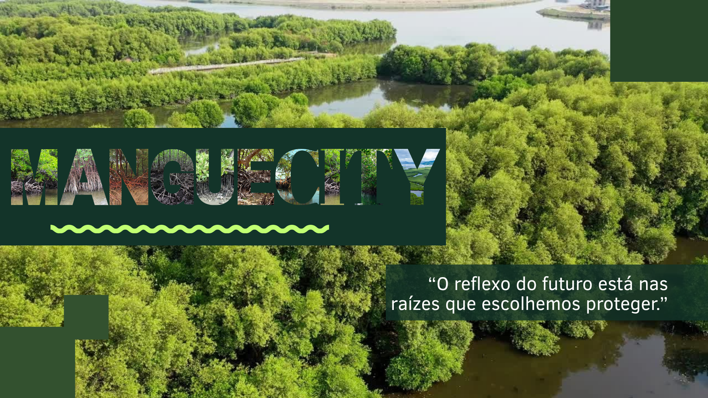
## 👀 How to view the project

MangueCity was delivered as a clickable prototype and a pitch, with no code to install.

1. **Prototype:** open https://www.figma.com/make/T1T2dKOrnz9WOFKcreg6B9 in your browser and browse the student, teacher and moderation screens.
2. **Pitch:** the 17 slides are in this README, starting at "About the Project", and in the files `1.png` to `17.png`.

## 🌿 About the Project

MangueCity is an educational, gamified web platform developed to bring children closer to the world of mangroves and environmental preservation. The proposal combines technology, playfulness, and education to encourage learning about one of the city's most important ecosystems.

"We only care for what we love, and we only love what we know." — unknown author

---

### Community Involvement and Parque das Graças
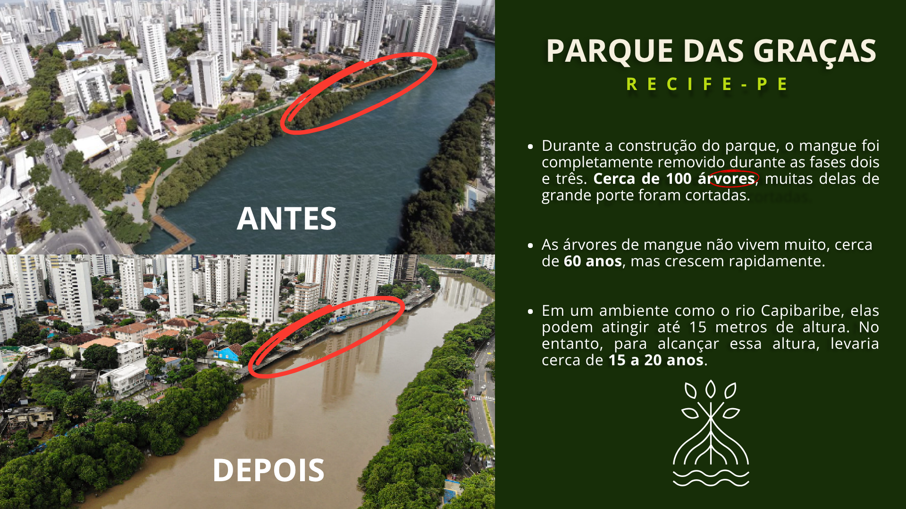

"During the construction of Parque das Graças, around 100 mangrove trees were removed. These trees take 14 to 20 years to fully grow."

### Social Importance
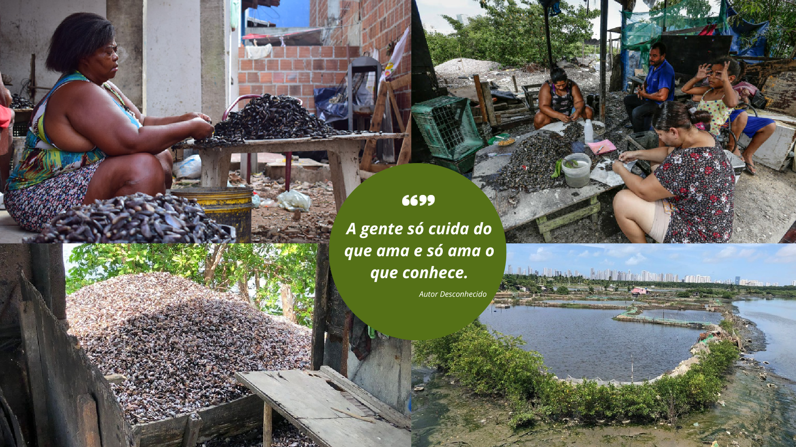

Many people make their living from the mangrove, from fishermen to shellfish gatherers.

### Socio-Environmental Importance
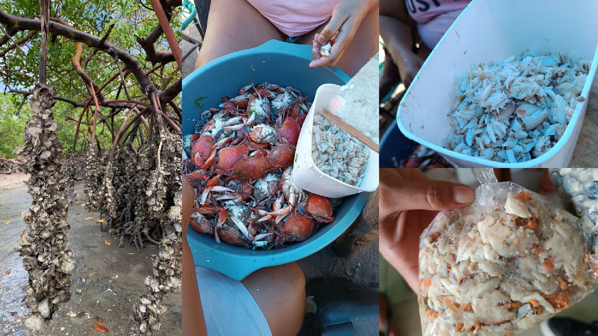

The mangrove has a socioeconomic function, but also an ecological one, acting as a natural nursery, absorbing carbon, and reducing coastal vulnerability to climate change.

## 🐚 The Importance of the Mangrove
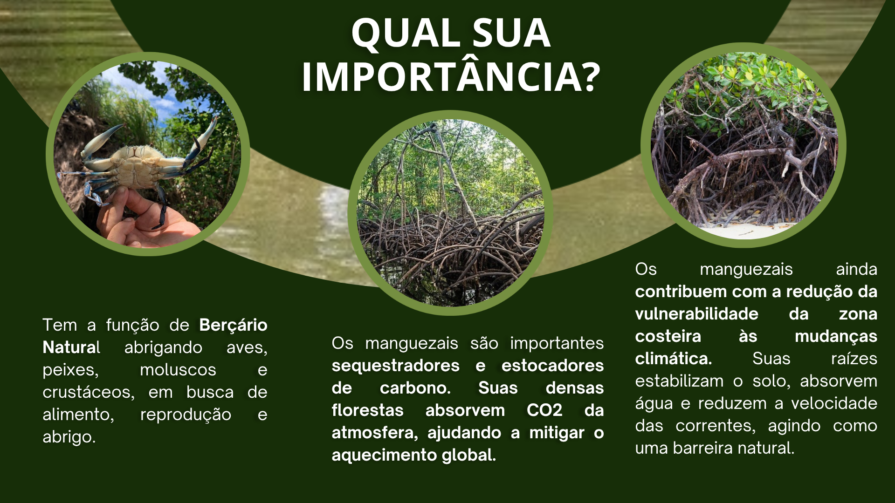
The mangrove functions as a natural nursery, sheltering birds, fish, mollusks, and crustaceans seeking food, reproduction, and shelter.
These ecosystems are also important carbon sinks and stores, helping mitigate global warming.
They also help reduce the coastal zone's vulnerability to climate change, since their roots stabilize the soil, absorb water, and slow currents, acting as a natural barrier.

### Carbon Absorption
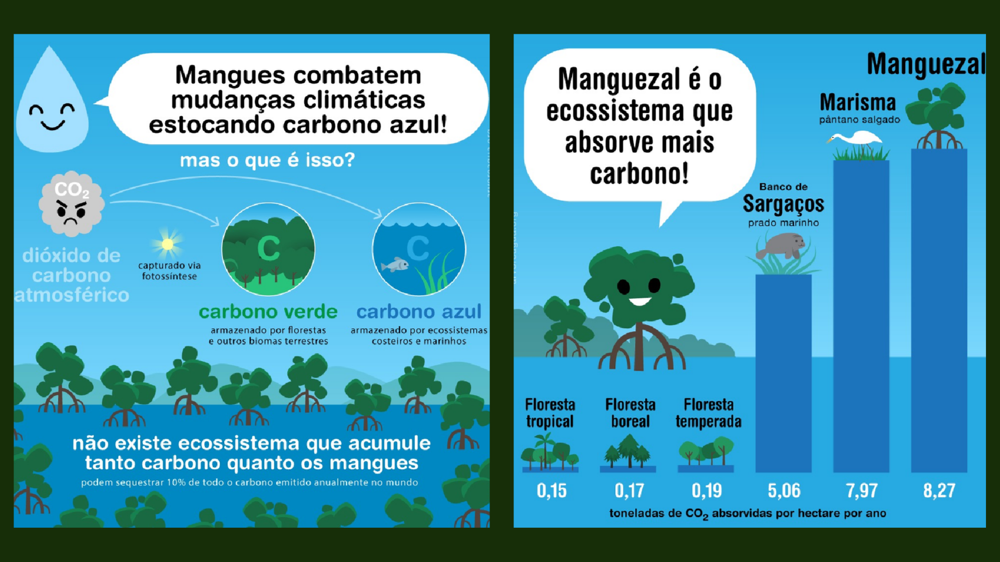

Mangrove trees absorb carbon through photosynthesis, making mangroves one of the biomasses that absorb the most carbon.

### Threats
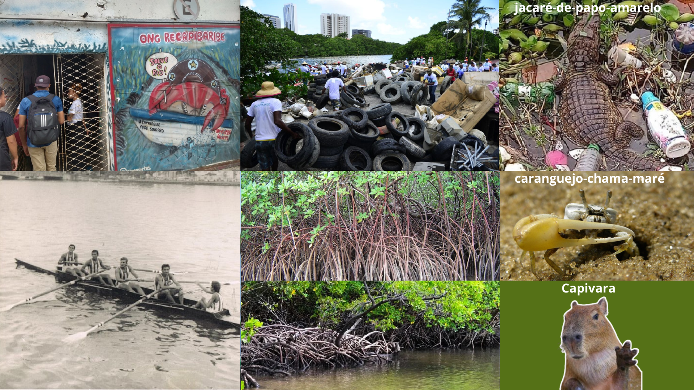

However, the mangrove and its species are threatened by pollution and deforestation.

### Biodiversity
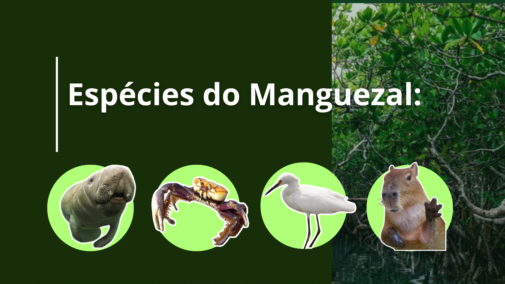

Some well-known species that live in the mangrove include manatees, giant land crabs, herons, and capybaras.

### Environmental Loss
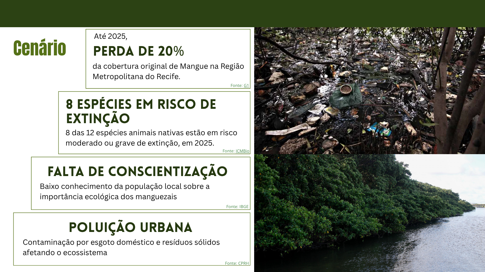
## 🌊 Current Scenario

Today the mangrove is significantly damaged due to urban pollution and deforestation.
The population's lack of knowledge about this ecosystem's essential ecological role makes the problem even worse.

- By 2025, there had been a 20% loss of the original mangrove coverage in Metropolitan Recife.
- Eight species are at risk of extinction.
- There is a lack of awareness among the local population about its ecological importance.
- Urban pollution contaminates the ecosystem with domestic sewage and solid waste.

By 2025, we had lost 20% of the mangrove in Metropolitan Recife. Eight species that live there are at risk of extinction, and the population's lack of awareness about its importance, its animals, and its biodiversity — along with urban pollution and deforestation — are threatening the mangrove's existence today.

### Cultural Reference
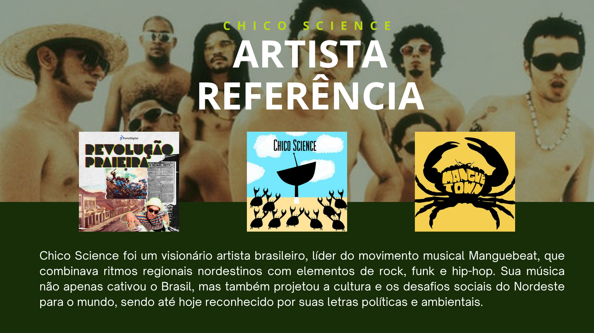

One of the artists who spoke most about the mangrove and brought visibility to this biome, so overlooked by the media, was Chico Science.

### The MangueCity Solution
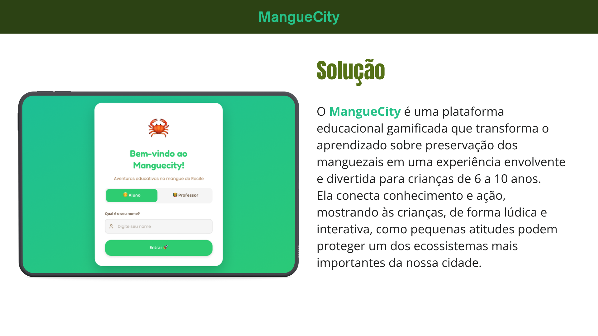
## 💡 The Solution

Aiming to bring people closer to the mangrove and make its value easier to understand, we created MangueCity.

Amid the chaos and the mud, we bring our solution: MangueCity is a gamified educational platform that turns learning about mangrove preservation into an engaging, fun experience for children aged 6 to 10.
It connects knowledge and action, showing children, in a playful and interactive way, how small actions can protect one of our city's most important ecosystems.
"Amid the chaos and the mud, we bring a solution: MangueCity is a gamified educational platform for children aged 6 to 10."

### Features
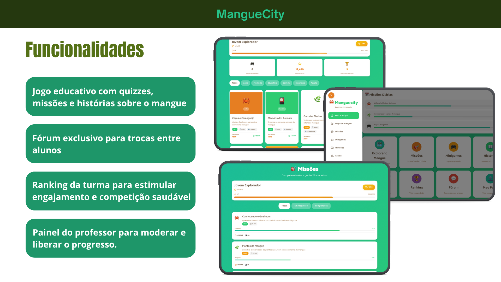

"We offer educational games, a student forum, class rankings, and a teacher dashboard."

### Differentiators
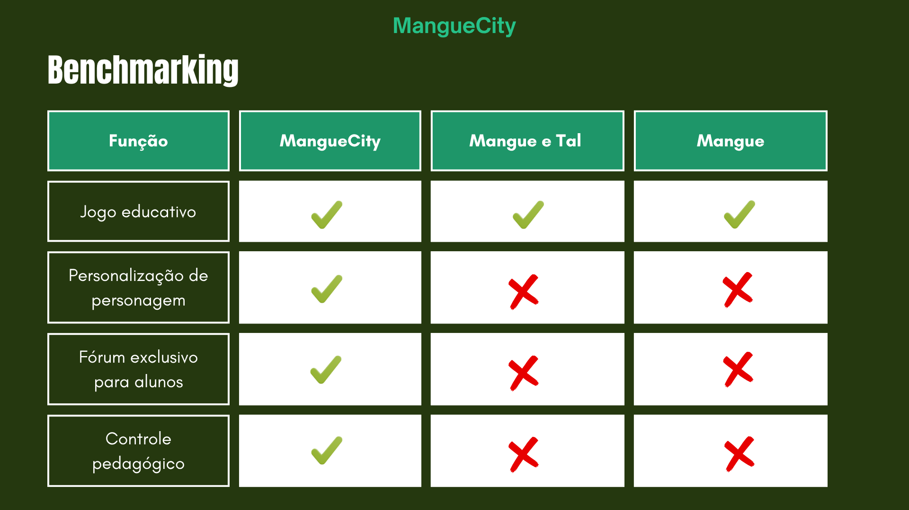

The app features educational games, quizzes, a forum exclusive to users, rankings, and a badge and trophy system to drive engagement, plus a teacher dashboard to moderate and unlock student progress. It also stands out from competitors because MangueCity is an educational game with character customization, a student-only forum, and complete pedagogical oversight.

### Business Model
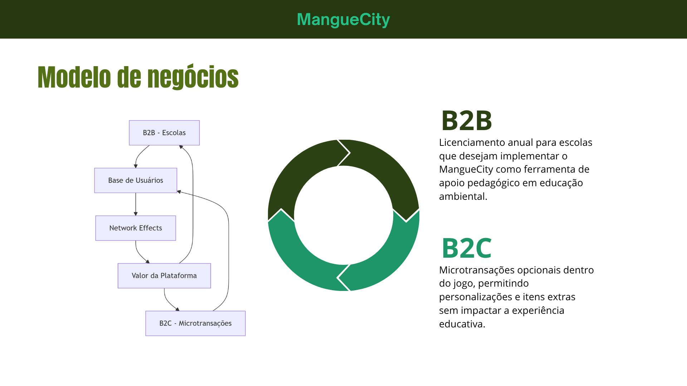
## 💼 Business Model
MangueCity's hybrid business model allows it to expand its revenue proposal with B2B, licensing the platform to interested schools, alongside in-app cosmetic microtransactions.
### B2B
Annual licensing for schools that want to implement MangueCity as a pedagogical support tool for environmental education.

### B2C
Optional in-game microtransactions, enabling customizations and extra items without impacting the educational experience.


### Sustainable Development Goals
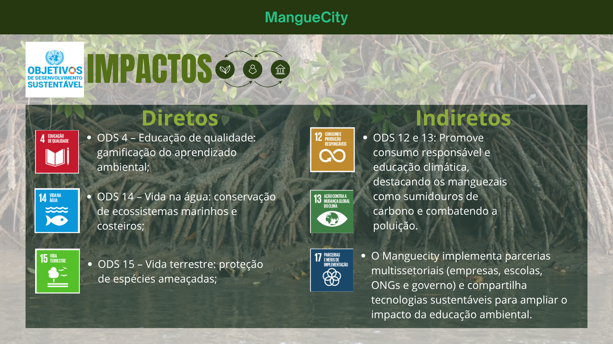

MangueCity supports 6 Sustainable Development Goals.
## 🌍 ESG and SDG Impact

MangueCity contributes to the following Sustainable Development Goals:

- SDG 4 – Quality Education: gamifying environmental learning.
- SDG 12 – Responsible Consumption and Production: encourages sustainable attitudes.
- SDG 13 – Climate Action: highlights mangroves as carbon sinks.
- SDG 14 – Life Below Water: conservation of marine and coastal ecosystems.
- SDG 15 – Life on Land: protection of endangered species.
- SDG 17 – Partnerships for the Goals: encourages multi-sector partnerships with schools, NGOs, businesses, and government.

### Impact
- **Environmental:** reduces damage to mangroves by teaching children sustainable attitudes.
- **Social:** strengthens environmental education and mobilizes schools and communities.
- **Economic:** lowers future cleanup and environmental restoration costs while driving sustainable educational solutions.

### Squad Mangue Limpo
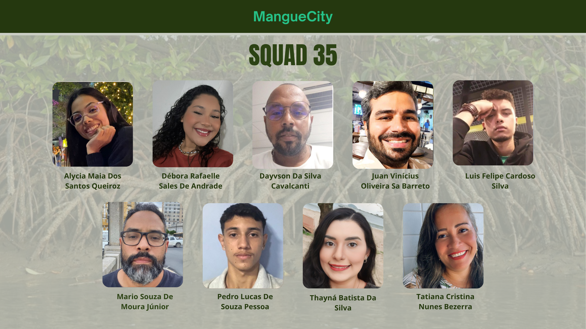

"We reduce environmental damage, strengthen education, and lower future recovery costs."
"Transforming the future starts with children's education — and MangueCity is here to make that happen."
### Team Members
- Dayvson Da Silva Cavalcanti
- Tatiana Cristina Nunes Bezerra — Research and Documentation Lead
- Juan Vinícius Oliveira Sá Barreto — Documentation
- Pedro Lucas de Souza Pessoa — Business Rules Lead
- Alycia Maia Dos Santos Queiroz — Business Rules, Documentation, and Personas
- Luis Felipe Cardoso Silva — Documentation
- Débora Rafaelle Sales de Andrade — Documentation
- Thayná Batista da Silva — Scrum Master · Requirements Analysis · Product Designer · Design and Prototyping (Figma)
- Mario Souza de Moura Júnior — Documentation and research, personas


### Prototype and QR Code
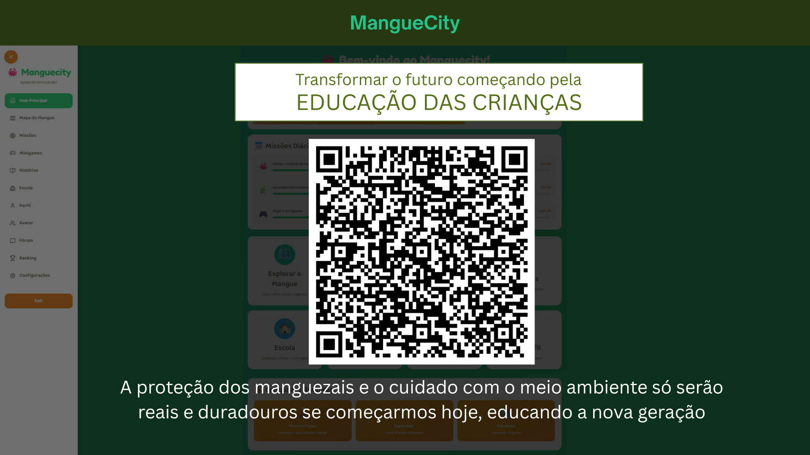

**MangueCity — "The reflection of the future lies in the roots we choose to protect."**
## ✨ Features

- Educational game with quizzes, missions, and stories about the mangrove 🎮
- Forum exclusive to student interaction 💬
- Class ranking to drive engagement and healthy competition 🏆
- Teacher dashboard to moderate and unlock progress 👩‍🏫
- Badge and trophy system to boost motivation 🥇
- Character customization 🎨

## 🎨 Prototype and Access
[Access the design on Figma](#)

## 🛠️ Technologies Used
- **React Native / Expo** — cross-platform mobile development
- **React Navigation** — smooth navigation between screens
- **Lucide React Native** — modern, lightweight icons
- **Styled Components** — organized, scalable styling

---

## 💻 Web Solution Base Code

```jsx
import React, { useState } from 'react';
import { Trophy, Trees, Trash2, Star, Award, Map } from 'lucide-react';

export default function ManguecityWeb() {
  const [ecoPontos, setEcoPontos] = useState(120);

  return (
    <div style={styles.container}>
      <header style={styles.header}>
        <div style={styles.logoArea}>
          <Trees color="#2ecc71" size={40} />
          <h1 style={styles.title}>Manguecity Kids</h1>
        </div>
        <div style={styles.scoreBoard}>
          <Star color="#f1c40f" fill="#f1c40f" />
          <span style={styles.scoreText}>{ecoPontos} Eco-Points</span>
        </div>
      </header>

      <main style={styles.main}>
        <section style={styles.welcomeSection}>
          <h2>Hello, Little Protector! 👋</h2>
          <p>The mangrove needs your help. Shall we learn and play?</p>
        </section>

        <div style={styles.cardDestaque}>
          <div style={styles.cardIcon}>
            <Trash2 color="#FFF" size={48} />
          </div>
          <div style={styles.cardContent}>
            <h3>Operation Clean Mangrove</h3>
            <p>Help the crab clean the mud and earn 50 points!</p>
            <button style={styles.buttonAction} onClick={() => setEcoPontos(ecoPontos + 50)}>
              Start the Adventure!
            </button>
          </div>
        </div>

        <div style={styles.grid}>
          <div style={styles.miniCard}>
            <Map color="#e67e22" />
            <span>Explore Map</span>
          </div>
          <div style={styles.miniCard}>
            <Award color="#9b59b6" />
            <span>My Badges</span>
          </div>
          <div style={styles.miniCard}>
            <Trophy color="#f1c40f" />
            <span>Ranking</span>
          </div>
        </div>
      </main>

      <footer style={styles.footer}>
        <p>Learning about the mangrove rocks! 🦀✨</p>
      </footer>
    </div>
  );
}

const styles = {
  container: { fontFamily: 'Arial, sans-serif', backgroundColor: '#e8f5e9', minHeight: '100vh', padding: '20px' },
  header: { display: 'flex', justifyContent: 'space-between', alignItems: 'center', backgroundColor: '#FFF', padding: '15px 30px', borderRadius: '50px', boxShadow: '0 4px 15px rgba(0,0,0,0.1)' },
  logoArea: { display: 'flex', alignItems: 'center', gap: '10px' },
  title: { color: '#2d3436', fontSize: '24px', margin: 0 },
  scoreBoard: { display: 'flex', alignItems: 'center', gap: '8px', background: '#34495e', padding: '10px 20px', borderRadius: '30px', color: '#FFF' },
  scoreText: { fontWeight: 'bold' },
  main: { maxWidth: '800px', margin: '40px auto' },
  welcomeSection: { textAlign: 'center', marginBottom: '40px' },
  cardDestaque: { display: 'flex', backgroundColor: '#27ae60', borderRadius: '24px', padding: '30px', color: '#FFF', alignItems: 'center', gap: '20px', boxShadow: '0 10px 20px rgba(39, 174, 96, 0.3)' },
  cardIcon: { backgroundColor: 'rgba(255,255,255,0.2)', padding: '20px', borderRadius: '20px' },
  cardContent: { flex: 1 },
  buttonAction: { backgroundColor: '#f1c40f', border: 'none', padding: '12px 25px', borderRadius: '12px', fontWeight: 'bold', cursor: 'pointer', marginTop: '10px', fontSize: '16px' },
  grid: { display: 'grid', gridTemplateColumns: '1fr 1fr 1fr', gap: '20px', marginTop: '30px' },
  miniCard: { backgroundColor: '#FFF', padding: '20px', borderRadius: '20px', display: 'flex', flexDirection: 'column', alignItems: 'center', gap: '10px', fontWeight: 'bold', color: '#34495e', cursor: 'pointer' },
  footer: { textAlign: 'center', marginTop: '50px', color: '#7f8c8d' }
};
```

---

## 📞 Contact 📬

Want to know more about the project or get in touch? 🤝

<div align="center">

  <a href="https://br.linkedin.com/in/thaynabds" target="_blank">
    
  </a>
  
  <a href="https://www.instagram.com/thaynabdstec/" target="_blank">
    
  </a>

</div>

📧 **Email:** [thaynabdstec@gmail.com](mailto:thaynabdstec@gmail.com) ✉️

📱 **Phone:** +55 (81) 97912-6121 📞

---

<div align="center">

### 👤 Thayná Batista da Silva
**Scrum Master • Product Designer • Requirements Analyst** 💼

Senac Recife-PE Faculty | Systems Analysis and Development 🎓


</div>

---

<div align="center">

**Thank you for visiting! ⭐ Don't forget to star the project if you liked it!** 🌟

[](https://br.linkedin.com/in/thaynabds)
[](https://www.instagram.com/thaynabdstec/)

</div>
